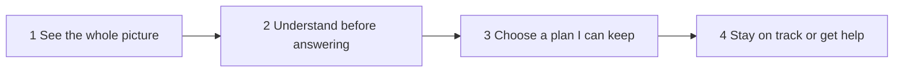

# Back in Flow: future-state journey map

**Case:** Riverty BU Collection, A Fair Way Forward
**Persona:** The quick closer (Mara)
**Strategy:** Move from fast plan creation to sustainable plan agreement, with clarity and affordability before commitment and a clear handoff to an agent.

> Sample data, illustrative, not Riverty research. All quotes, tickets and figures come from the fictional cohort 2 data pack.

## Timeline

## The four stages

### 1. See the whole picture

- **User action:** Opens the reminder link and sees all open claims in one view → knows the full amount at once.
- **User action:** Checks the amount against her letter → numbers match, so no reason to call.
- **Internal state:** "Okay, this is everything I owe."
- **Pain point addressed:** Claims shown one at a time (N-03, T-202); portal amount differs from letter, mostly purchased portfolios (N-07, T-203).

### 2. Understand before answering

- **User action:** Reads a plain note on why income is asked → stops fearing her answer is used against her.
- **User action:** Enters a "normal month" income for shift work → no guessing which month is meant.
- **User action:** Uploads a document that works on mobile, or skips it under a set amount → finishes on her break.
- **Internal state:** "I know why they ask, and I can answer honestly."
- **Pain point addressed:** Ambiguous income question (N-01), fear of misuse (N-06, T-206), mobile upload timeouts (T-201).

### 3. Choose a plan I can keep

- **User action:** Sees plans ranked by fit with her income, not shortest first → avoids the "right answer" trap.
- **User action:** Reads what happens after a missed payment before confirming → commits knowing the consequences.
- **User action:** Picks a payment date that matches pay day → payments leave when money is there.
- **Internal state:** "I know this works, and I know what happens if something goes wrong."
- **Pain point addressed:** Shortest plan chosen and broken (N-02); chat confirms without consequences (N-05, T-208).

### 4. Stay on track or get help

- **User action:** Gets a reminder before each due date → no surprise missed payment.
- **User action:** Calls an agent who already sees her inputs and the plan reason → no starting over.
- **Internal state:** "If I need help, I don't have to explain everything again."
- **Pain point addressed:** Reminder after due date (T-207); agents blind to online inputs (N-08, N-09, T-205).

## Three competitive advantages over the manual workaround

1. **Certainty replaces the phone call.** The questions that drive agent calls are answered inside the journey, before commitment.
2. **A plan that fits replaces a guess.** Plans match real, variable income, so fewer break within 60 days.
3. **Context travels with the case.** When an agent is needed, they start from what Mara already entered.
